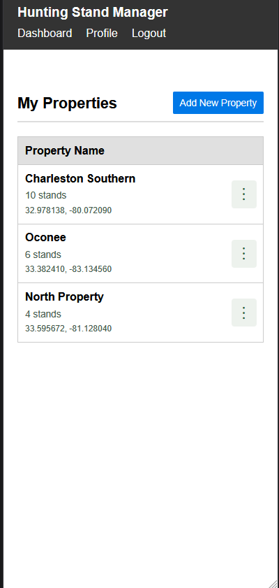
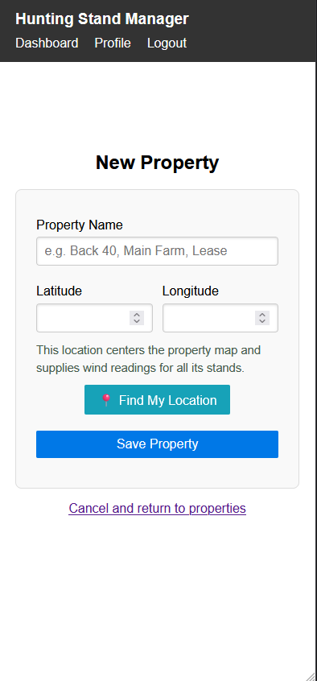
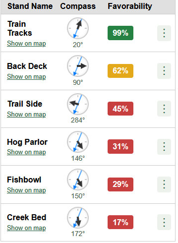
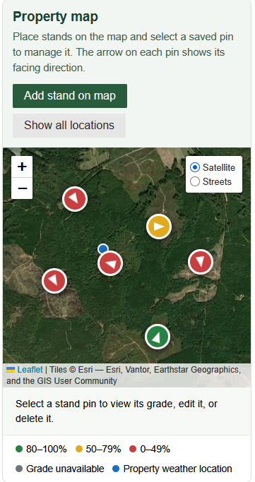

# Hunting Stand Weather Manager
**Date**: September 1, 2026  
**Student**: Andrew Taylor  
**Major**: Computer Science  
**Degree**: BA in Applied Computing, Emphasis Cybersecurity
**Project Advisor**: Dr. Sean Hayes

---

## 1. Statement of Purpose
### Problem Statement
When managing a hunting property with multiple stands, it can be difficult for hunters to determine the most advantageous location to hunt at any given time. Wind direction plays a critical role in hunting, as wind blowing from the hunter toward the game's expected location can easily give away their scent, ruining the hunt. Hunters need a quick, reliable way to cross-reference current wind data with their specific stand facings.

### Purpose
The *Hunting Stand Weather Manager* is a web application designed to solve this problem by automatically retrieving local weather data and grading a user's hunting stands based on how favorable the wind direction is. By providing a dashboard that ranks stands from best (A) to worst (F), the application enables hunters to make informed, data driven decisions on where to hunt.

## 2. Research & Background
Effective deer hunting relies heavily on scent control and wind awareness. Whitetail deer possess an incredibly acute sense of smell, capable of detecting human scent from hundreds of yards away depending on the wind. The mathematical challenge of this project involved taking a stand's facing degree (e.g., North = 0°) and comparing it against the wind direction degree (where the wind is blowing from). A mathematical algorithm was developed to calculate the absolute angular difference and convert it into a percentile score, where a wind blowing directly into the hunter's back is optimal (100%), and wind blowing directly into their face is the worst-case scenario (0%). 

Additionally, research was conducted into weather data providers, culminating in the decision to use the free U.S. National Weather Service (Weather.gov) API to avoid rate limits and costs associated with commercial APIs like OpenWeatherMap.

## 3. Project Language(s), Software, and Hardware
- **Languages**: Python (Backend logic), HTML, CSS, JavaScript (Frontend UI), SQL
- **Software/Frameworks**: Flask (Web Framework), Flask-SQLAlchemy (ORM for Database), Flask-Login (Authentication), Pytest (Testing Framework), SQLite (Database)
- **Hardware**: Standard laptop/desktop for development, standard web servers for deployment, accessible via any modern mobile or desktop browser.

## 4. Project Requirements
The project was built against a strict set of requirements:
- **Functional**: Users must be able to create, edit, and delete properties and stands. The system must query the Weather.gov API for wind data and generate a grade for each stand.
- **Usability**: The dashboard must rank stands intuitively, using color coding and clear grades (A-F).
- **Performance**: The database must enforce strict one-to-many relationships with cascading deletes. Weather data must be cached locally for 1-hour durations to minimize redundant API calls and improve load times.
- **Security**: User passwords must be securely hashed. Data isolation must be strictly enforced so users can only access their own properties and stands.

## 5. Project Implementation Description & Explanation
The application is implemented using the Flask App Factory pattern, separating routing, models, and forms into distinct modules. 

**Database Architecture:**
The `models.py` file defines a relational database using SQLAlchemy. A `User` can have multiple `Property` records, and each `Property` can have multiple `Stand` records. A cascading delete ensures that removing a user wipes all their associated data.

**Grading Algorithm:**
The `current_score(wind_degree)` method on the `Stand` model handles the logic. It calculates the shortest angular distance between the wind direction and the stand's facing direction. 

**Weather API Integration:**
The `weather.py` module manages the 3-step NWS API process (Points -> Stations -> Latest Observation) and implements an in-memory caching dictionary to temporarily store wind data by coordinate to prevent rate limiting.

### User Interface & Walkthrough

- **Figure 1. User Properties.** Shows the list of properties belonging to the user.

- **Figure 2. Property Management.** Shows the form for creating a new property.

 
- **Figure 3. The Dashboard.** Shows the ranked list of stands, color-coded by their grade.
- **Figure 4. Stand Creation.** Shows the interface for adding a stand's facing degree.

**Source Code Repository:** [Link to GitHub Repository](https://github.com/soverc89/CSU-Senior-Project-aTaylor)

## 6. Test Plan
The comprehensive test plan detailing Unit, Integration, Regression, and User-Acceptance tests can be found here:
- [Test Plan Document](testplan.md)

## 7. Test Results
Automated unit, integration, and regression testing achieved a 100% pass rate across 17 test cases, validating grading logic, database relationships, API mocking, and security constraints.
- [Test Results Report](Test_Results.md)
- [User Acceptance Testing Scripts](UAT_Plan.md)

### User Questionnaire Feedback

Questionnaire responses rated map-based stand creation as 5 out of 5 for ease of use. Feedback indicated that the dashboard immediately communicated which stand was most favorable to hunt, and no features were identified as unnecessary. These findings provide positive evidence for the perceived usability of the prototype's stand-creation and ranking workflows.

Suggested additions included precipitation probability, advance stand planning, stand photos, camera integration, and property-boundary mapping. The suggestions inform the future-development roadmap. Questionnaire findings are documented separately from automated functional and security verification in the [Test Results Report](Test_Results.md#user-questionnaire-results).

## 8. Challenges Overcome
- **NWS API Structure**: The Weather.gov API does not allow querying weather directly by coordinates. It required a multi-step request process: converting coordinates to a grid point, finding the nearest observation station, and then querying that station's latest observation. This was overcome by building a robust `WeatherManager` class.
- **Testing API Dependencies**: Testing the weather integration without making actual network calls (which can be slow or fail in CI environments) was challenging. This was overcome by utilizing Python's `unittest.mock` to intercept `requests.get` and inject mock JSON responses.
- **Mathematical Logic**: Determining the shortest distance between two degrees on a 360-degree circle required careful mathematical formulation to ensure it always scaled correctly between 0% and 100%.

## 9. Future Enhancements
Potential future enhancements include the existing roadmap and suggestions from questionnaire feedback. They are outside the agreed presentation-prototype scope.

### Existing Roadmap

1. **Dark Mode**: To prevent glaring screens from ruining a hunter's night vision during pre-dawn setup.
2. **Long Range Planner**: Using historical weather trends to predict stand viability months in advance.
3. **Lunar Phase & Sunrise/Sunset Integration**: Adding a calendar view that tracks solar and lunar cycles, which heavily influence game movement.
4. **Shared Stand Groups**: Converting the One-to-Many property relationship to a Many-to-Many relationship, allowing hunting clubs to share stands across multiple user accounts.

### Questionnaire Suggestions

- **Precipitation Probability**: Display the chance of precipitation to help users consider additional weather conditions.
- **Advance Stand Planning**: Compare projected stand favorability before a future hunt. This aligns with the deferred forecast planner and is distinct from the historical-data long-range planner.
- **Stand Photos**: Add photographs to individual stand records.
- **Camera Integration**: Associate relevant camera information with properties or stands.
- **Property Boundaries**: Mark or display property boundaries on the map.

## 10. Defense Presentation Slides
- [Link to Presentation Slides (Pending)]

---

## References & AI Citation
- National Weather Service API. (2026). *API Web Service*. https://www.weather.gov/documentation/services-web-api
- OpenAI. (2026). *ChatGPT (GPT-4)* [Large language model]. Used for assistance with prototyping test logic, creating test plans, and generating pytest scripts. https://chat.openai.com/
